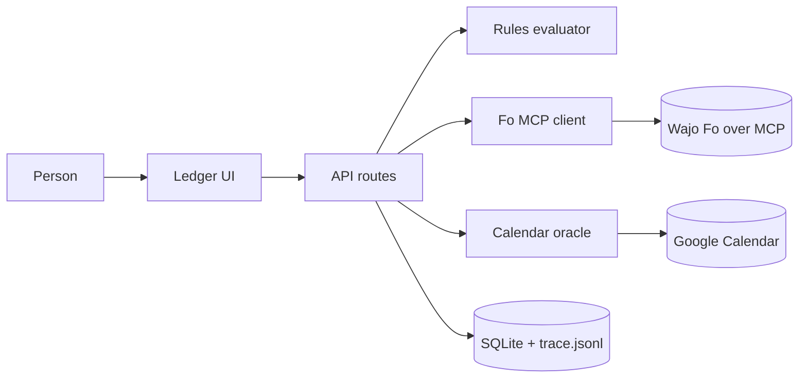

# Architecture — Receipts
Mode: hackathon. Last structural change: 2026-10-18 (ADR-0001 to ADR-0004).

## Overview
Receipts is a single Next.js app, run locally for the judged take, that sits between a person and Wajo's Fo agent. The person writes three standing rules once. Each errand they type is evaluated by plain code against those rules: inside policy it is sent to Fo over MCP from the person's own account; outside policy it waits on a card. Every task carries a postcondition. When Fo says done, Receipts reads the person's own Google Calendar and marks the receipt verified only if the event is there. Every Fo tool call, decision and check is logged to SQLite and an append-only JSONL trace. No model runs in Receipts; Fo is the agent.

## Components
| Component | Responsibility | Tech | Why it exists (requirement) | When it fails |
|---|---|---|---|---|
| Web UI (`app/`) | the ledger: rules strip, compose, held card, receipt rows, trace drawer; `/connect`; `/about` | Next.js 16 App Router, React 19, Tailwind 4 tokens from UI-SPEC | M6, M7, M9 | the page still renders the seed row and fixtures (`?state=`) with no backend |
| API routes (`app/api/**`) | tasks, decisions, polling, checks, rules, trace, OAuth callbacks | Next route handlers, Node runtime | M1–M5, M7 | errors return the field or the provider's words; the UI keeps the input |
| Rules evaluator (`lib/rules.ts`) | deterministic allow/hold with the rule id and a plain reason | TypeScript, zod | M1, M4 (Trust by design) | pure function; no failure mode beyond invalid input (400) |
| Fo client (`lib/fo/client.ts`, `lib/fo/oauth.ts`) | OAuth 2.1 PKCE + dynamic registration, Streamable HTTP, typed wrappers for ask_fo, get_fo_reply, get_fo_conversation | `@modelcontextprotocol/sdk` 1.32 | M3 (the mandatory sponsor) | 401 → refresh → re-auth link; 429 or SSE drop → backoff with the row saying so; 15 min → "Fo is still working" |
| Drafter (`lib/draft.ts`, `app/api/draft/route.ts`) | one sentence -> counterparty, kind, amount, postcondition, for the person to confirm | one OpenAI-compatible call (Vercel AI Gateway by default, any base URL; OIDC token or key) with a no-network reading of the words as the fallback | the first ten seconds of the demo; agent craft | timeout 8 s -> the words draft and the status line says so; a name the sentence does not hold is dropped; the rules never see the draft |
| Fake Fo (`lib/fo/fake-server.ts`) | the same five tools with scripted replies for tests and development | SDK `McpServer` + `InMemoryTransport` | M8 (no OAuth yet; failure-path tests) | labelled "Simulated Fo"; never in the take |
| Runner (`lib/runner.ts`) | the task state machine: evaluate → dispatch → poll → claim → check → verify / re-ask / manual | TypeScript | M3, M5 | each transition is logged; a crash leaves the task resumable from its stored state |
| Oracle (`lib/google.ts`, `lib/check.ts`) | Google OAuth (offline, calendar.readonly) and `events.list` within the postcondition window | fetch, no SDK | M5 (the frontier line) | token expired → refresh; revoked → "no calendar connected; confirm by hand" |
| Store (`lib/db.ts`, `lib/schema.ts`) | rules, contacts, tasks, trace_events, oauth | Node's built-in `node:sqlite` (no native module), WAL | M1–M7; one datastore (law 2) | a locked file retries; the JSONL trace is the second copy |
| Trace (`lib/trace.ts`) | append each event to SQLite and `data/trace.jsonl`; export per run with token redaction | fs append | M7 (form items F and G) | a write failure is logged to stderr and the UI shows "trace write failed" on the row |

## Data flow

## External services
| Service | Used for | Failure mode | Fallback | Limits / quota |
|---|---|---|---|---|
| Wajo Fo MCP (https://mcp.api.wajo.ai/fo) | performing the errand; its progress and claim | 401, 429, long `working`, a confirmation question, SSE drop | refresh or re-auth; backoff; answer the question from the approval or forward it; 15-minute notice | plan-gated: Fo Mini excludes other clients (wajo.ai/support); 1000 tasks/day on the free tier (wajo.ai); latency unconfirmed |
| Google Calendar API v3 | the oracle (`events.list`) | expired or revoked token; 403 scope | refresh; re-auth; manual tick | 1,000,000 queries/day default; testing-mode consent screen needs the user as a test user |

## Key decisions
- ADR-0001 One Next.js app with SQLite and a JSONL trace, no Postgres and no Vercel for the judged take — the event needs a video and a form, not a live link; one datastore survives a crash and exports the trace as a file.
- ADR-0002 Be the MCP client with the official SDK's OAuth provider (dynamic registration, PKCE), tokens in SQLite, a localhost redirect — the only way to drive Fo from the entry's own backend; Claude as the client would show Fo but add nothing of ours.
- ADR-0003 The oracle is the user's own Google Calendar read-only, never Fo's reply — the frontier claim; the manual tick is a different state, never shown as verified.
- ADR-0004 A fake Fo over InMemoryTransport for tests and development, labelled on screen and excluded from the run count — the real Fo needs the user's OAuth, which arrives late; failure paths (401, a confirmation question, a never-completing task) are scripted there.
- ADR-0005 No model in the entry; the user types the task's fields and postcondition — no Claude credits, and the evaluator and checker decide; a field-suggesting model is a COULD.

## Failure boundaries
Fo unreachable: the task stays "sent" and the row says "Fo is not answering; still trying"; after a failed poll the next try waits 30 s; a token Fo refuses mid-session drops the connection and the row says "Fo needs reconnecting". There is no timeout: a real errand (an email the clinic answers tomorrow) may take hours, so only the person ends a task, by declining to confirm it. Calendar unavailable: the receipt is unverified with the reason and offers the manual tick. SQLite locked: the write retries three times (WAL); the trace JSONL still appends. Idempotency: one ask_fo per task (a `dispatched_at` guard); polling and checking are safe to repeat. No automatic retries on ask_fo (a second ask would be a second errand): a task Fo did not accept ends "failed, not sent" and is sent again only by the person's "Try sending again".

## Deployment
Local for the take: `npm run dev` (or `npm run build && npm start`) on http://localhost:3100 (APP_URL must match, since both OAuth redirects are built from it); secrets in `.env.local` (GOOGLE_CLIENT_ID, GOOGLE_CLIENT_SECRET, FO_MCP_URL, FO_MODE); tokens in `data/receipts.db` (gitignored). Stretch (C2): a static snapshot of the ledger on Vercel. Rollback: `git revert`; the SQLite file is disposable in demo mode (`Alt+Shift+R` clears the ledger and starts a new run; `?demo=1` seeds one simulated run).

## Observability
Every Fo call, decision, check and error is a trace_event with a timestamp, in SQLite and `data/trace.jsonl`; the trace drawer reads them; the run-count table is computed from tasks. Server errors log to stderr with the task id.

## Known tradeoffs
Single local user; the counterparty address in the demo is a second mailbox the builder controls (disclosed); Fo's latency is outside our control, so the take may wait; the postcondition is typed, not inferred.
