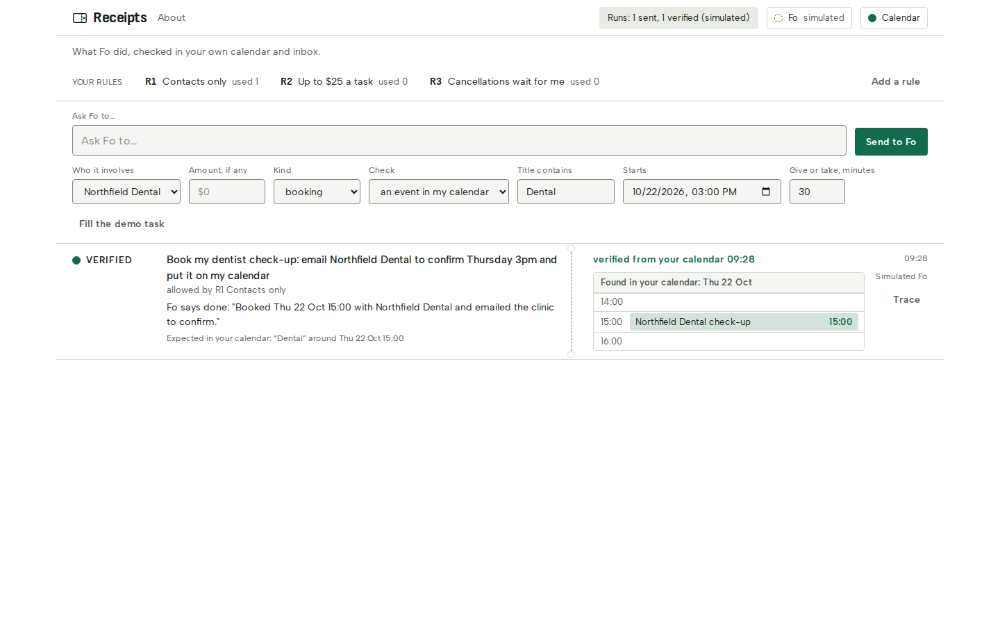

# Receipts

**Fo says done. Receipts checks your own calendar before believing it.**

Receipts sends your errands to Wajo's Fo agent under rules you wrote once, then reads your own Google Calendar to confirm the result landed.



Built at the GSD (Get Sh\*t Done) Hackathon, Wajo × Claude, 17 to 19 October 2026. Everything here, including the planning notes kept outside this repository, was written during the event; the research package that chose the idea was finished on 18 October, after hacking opened.

Demo video: one unedited take, about 35 seconds, attached to the X post (form item A). The run trace and the run count are in `SUBMISSION.md`.

Try the ledger without an account: **https://receipts-lack-toes.vercel.app** runs a simulated Fo and a simulated calendar (every row says so, and the banner says what is shared). The real run is the video; the repository is https://github.com/itssaharsh/receipts.

## What you see

- Every receipt shows Fo's claim beside what your calendar actually holds.
- Tasks inside your three rules go without asking; anything else waits for one tap.
- Each run is logged with Fo's tool calls, and the run count is reported as it is: sent, verified, withheld.

## How it works

1. Write three rules once: who Fo may contact, how much it may spend, what always waits for you.
2. Ask Fo for something in one sentence. A drafter proposes who it involves, the kind, the amount and the check (which event should appear in your calendar, and when); you edit anything, then send. Receipts sends it if the rules allow, or holds it for your tap (approve once, approve and add a rule, decline). The rules evaluate the fields you confirmed, never the draft.
3. When Fo says done, Receipts looks in your calendar and marks the receipt verified, or asks Fo again, then offers a manual tick that is shown as "confirmed by you", never as verified.

## What is real and what is simulated

| Part | In the recorded run |
|---|---|
| Fo (Wajo's action agent) | live, over MCP from the person's own Wajo account (OAuth with PKCE and dynamic client registration) |
| The calendar check | live, Google Calendar API, read-only, the person's own primary calendar |
| The rules evaluator, the held queue, the ledger, the trace, the calendar check | plain code in this repository; no model decides anything |
| The drafter (one sentence to fields and a check) | a small model over Vercel's AI Gateway (`google/gemini-2.5-flash-lite` by default, about a second; `DRAFT_MODEL` picks another, a Claude model with paid gateway credits), with a rules-based reading of the words as the fallback when the model is off or slow; the status line says which one drafted, and the draft is logged in the trace |
| The clinic in the demo task | a second mailbox the builder controls, named on the receipt |
| `FO_MODE=fake` and `ORACLE_MODE=fake` | an in-process simulated Fo and a simulated calendar for development and tests; every such row says "Simulated Fo" and those runs are left out of the run count |

## Run it

```bash
cp .env.example .env.local      # fill GOOGLE_CLIENT_ID and GOOGLE_CLIENT_SECRET; set FO_MODE=live
vercel env pull .env.local      # optional: a 12-hour AI Gateway token for the drafter (or set AI_GATEWAY_API_KEY); without it the words draft
npm install
npm run dev                     # port 3100; then open http://localhost:3100/connect to connect Fo and Google Calendar
```

For a look without any account: `FO_MODE=fake ORACLE_MODE=fake npm run dev` and open `http://localhost:3100/?demo=1`. Every row state is also reachable with `?state=verified|held|working|unverified|manual|withheld|failed|awaiting|empty|disconnected`.

Shortcuts: `Alt+Shift+R` clears the ledger and starts a new run; `Alt+Shift+P` replays the recorded real run (saved with `POST /api/replay`). `?record=1` docks notices away from the receipts for screen recording.

## Verify

```bash
npm test            # rules, trace, Fo client and OAuth against a fake Wajo, runner, decisions, calendar check, Google oracle, routes, states, replay
npm run typecheck
npm run build
```

## Architecture

One Next.js app, Node's built-in SQLite plus an append-only JSONL trace, an MCP client to `https://mcp.api.wajo.ai/fo`, a read-only Google Calendar oracle, and a drafter behind one OpenAI-compatible call. See `ARCHITECTURE.md`. The judged path and the event's criteria are in `.prod-build/contract.md` §12.

## Tools used to build it

Claude Code (the Claude agent) wrote the code, tests and documents with the builder; the plan, contract and evidence ledger are in `.prod-build/`. Fo was never asked by a page load: only the person's own send.
